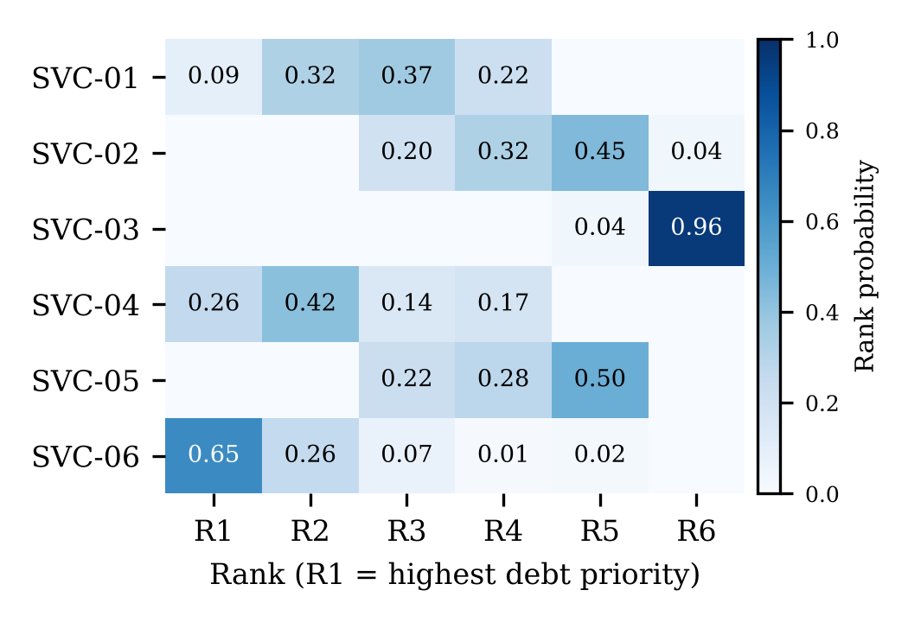

# Introduction {#sec-intro}

[T]{.IEEEPARstart}[echnical]{} debt (TD) describes the implied future cost of accepting short-term technical compromises over more robust solutions [@cunninghamWyCashPortfolioManagement1992]. The concept has expanded from source code quality to the architectural, design, test, documentation and infrastructure dimensions of complex IT systems [@kruchtenTechnicalDebtMetaphor2012]. Its operational and financial consequences are measurable and compound within a few years [@bankerTechnicalDebtFirm2020]. In financial trading environments they are intensified by continuous availability requirements, vendor-dominated architectures and regulatory oversight [@finmaCircular202312024]. The absence of a quantitative prioritisation mechanism is therefore particularly costly in this setting [@hakiDigitalNudgingTechnical2023; @ramasubbuControllingTechnicalDebt2021].

The literature does not yet offer a standardised, quantitative framework for measuring and prioritising TD at the service level in vendor-dominated enterprise IT. In a review of 44 primary studies, Lenarduzzi et al. [@lenarduzziSystematicLiteratureReview2021] found that quantitative multi-criteria approaches are uncommon and that empirical validation on industrial datasets is rare. Much of this gap follows from where existing tools look. The dominant tools operationalise debt as the remediation effort implied by source code rule violations [@biazottoTechnicalDebtManagement2024]. This makes them inapplicable where source code is unavailable, as is typical for the outsourced components and on-premises vendor software that form the core of trading IT. Even where code can be accessed, tools run against the same codebase return substantially divergent estimates [@amanatidisEvaluatingAgreementTechnical2020], and they leave infrastructure lifecycle debt, platform obsolescence and vulnerability debt largely unaddressed.

Operational data offers a route around this constraint. The four delivery performance measures of the DevOps Research and Assessment (DORA) programme are validated predictors of software delivery performance [@forsgrenAccelerate2018]. The further step from degraded operational indicators to elevated TD severity has not been established empirically, so this study treats it as a testable proposition rather than a premise. None of the work reviewed applies a multi-criteria decision-making (MCDM) method to live service management data in order to produce a ranked TD prioritisation instrument for financial trading IT.

This paper closes that gap. It presents a service-level framework that ranks IT services by TD priority using the Technique for Order of Preference by Similarity to Ideal Solution (TOPSIS) [@hwangMultipleAttributeDecision1981] on five indicators drawn from live IT service management (ITSM) and configuration management database (CMDB) records. The framework was built and evaluated within the trading IT division of a systemically important Swiss financial institution, following a design science approach [@hevnerDesignScienceInformation2004]. Three research questions guide the work.

- RQ1: How can TD in mission-critical trading systems be prioritised quantitatively at the service level using operational data?
- RQ2: To what extent do operational service management metrics serve as valid proxies for TD severity in vendor-dominated enterprise IT?
- RQ3: How stable are the resulting service rankings when criterion weights are perturbed?

The contributions are as follows. First, the paper proposes an operationally defined indicator set with an explicit mapping to TD dimensions, which can be extracted from ITSM and CMDB systems without source code access. Second, it reports, to the best of our knowledge, the first application of TOPSIS to live service management records for TD prioritisation in financial trading IT. Third, it provides a six-strand analytical evaluation covering weight sensitivity and weight-space robustness, convergent and discriminant validity, rank reversal, indicator independence and practical validity, and it shows how an absolute-mode TOPSIS variant removes rank reversal in this setting. Fourth, it documents a methodological finding of wider relevance: vector-normalised TOPSIS can reward a service simply for being the worst in the sample, whereas VIKOR and the absolute-mode variant do not, and this difference can reorder the top of a ranking.

A note on terminology is in order. The framework measures debt indirectly through operational proxies and expresses the result as a relative priority. It produces a quantitative, reproducible ordering of services by debt priority, not an absolute quantity of debt.

The remainder of the paper is organised as follows. @sec-related reviews the literature and states the research gap. @sec-method describes the research design, the indicators, the TOPSIS formulation and the evaluation approach. @sec-results reports the data preparation and rankings. @sec-evaluation presents the evaluation. @sec-discussion answers the research questions and discusses implications and threats to validity. @sec-conclusion concludes and identifies future work.

# Background and Related Work {#sec-related}

Four bodies of literature intersect at the problem addressed here: the theory of TD, approaches to its measurement and prioritisation, its governance in regulated financial IT and multi-criteria decision-making. Sources were identified through Scopus, IEEE Xplore and Google Scholar searches conducted between January and April 2026 and extended by citation snowballing on three anchor publications [@kruchtenTechnicalDebtMetaphor2012; @lenarduzziSystematicLiteratureReview2021; @forsgrenAccelerate2018]. The review is a narrative synthesis, since the problem spans three disciplines with differing evidence standards.

## The Expanding Perimeter of Technical Debt

Cunningham introduced the metaphor to explain a refactoring strategy to non-technical stakeholders [@cunninghamWyCashPortfolioManagement1992]. McConnell distinguished principal, recurring interest and compounding interest, and separated intentional from unintentional debt [@mcconnellManagingTechnicalDebt2008]. Kruchten et al. formalised a taxonomy covering code, design, architectural, test, build and documentation debt [@kruchtenTechnicalDebtMetaphor2012], which underpins much subsequent empirical work. Developers in industrial settings spend roughly 23% of their time dealing with the consequences of existing TD, with architectural debt exerting the strongest negative influence on productivity [@beskerTechnicalDebtEmpirical2020]. TD is also a sociotechnical phenomenon in which communication failures drive accumulation at least as much as technical decisions do [@ahmadTechnicalDebtNot2026], and in complex systems it may never be fully removed [@vidoniInfiniteTechnicalDebt2022].

The perimeter of TD has widened well beyond source code. Kleinwaks et al. showed that requirements, architecture, integration and verification artefacts all accumulate debt in systems engineering lifecycles [@kleinwaksTechnicalDebtSystems2023]. Hanssen et al. identified regulatory change as a debt trigger, where architectural decisions that were adequate before the Payment Services Directive 2 became sources of scalability debt once new requirements were imposed [@hanssenIdentifyingScalabilityDebt2019]. Yang et al. proposed a taxonomy of debt for commercial off-the-shelf (COTS) intensive systems that includes vendor platform obsolescence and integration constraints [@yangTaxonomyTechnicalDebt2019]. This broader view matters for trading IT, where vendor platforms often form the core of the operational stack and where platform, infrastructure and vulnerability debt are invisible to static analysis.

## Measurement and Prioritisation

Static analysis tools such as SonarQube, SQALE and CAST dominate TD measurement, operationalising debt as estimated remediation effort derived from rule violations. In a systematic mapping of 178 studies, Biazotto et al. found that most automated measurement artefacts remain code-level, require substantial human intervention and rarely support end-to-end TD management [@biazottoTechnicalDebtManagement2024]. Industry platforms such as SDK4ED integrate several code-level techniques but offer little support for infrastructure and vendor-platform debt [@ampatzoglouSDK4EDPlatformTechnical2022], and the business relevance of code quality, confirmed across 39 proprietary codebases [@tornhillCodeRedBusiness2022], does not resolve the blind spots of a code-only view. Measurement consistency is a further concern, since tools run against the same codebase return substantially different estimates because each relies on its own ruleset and thresholds [@amanatidisEvaluatingAgreementTechnical2020]. Infrastructure and process debt remain understudied relative to code and architectural debt [@albuquerqueManagingTechnicalDebt2023].

Prioritisation shows the same lag. Lenarduzzi et al. found that existing approaches cluster around cost-based, value-based and risk-based strategies, that most adopt a single primary criterion and that quantitative methods are less common than heuristics [@lenarduzziSystematicLiteratureReview2021]. The operational stakes are concrete. De Toledo et al. showed that targeted repayment of architectural TD in a production microservices system reduced incidents by 84% [@detoledoReducingIncidentsMicroservices2021]. Practitioners weigh value and cost together rather than acting on a single factor [@alfayezHowSonarQubeidentifiedTechnical2023], and their decisions reflect technical severity, business impact and available effort at once [@pinaTechnicalDebtPrioritization2022]. Most IT managers nonetheless lack a formal TD management process [@wieseITManagersPerspective2023]. The Continuous Debt Valuation Approach assigns a financial value to each debt item [@stochelBusinessdrivenTechnicalDebt2023], yet it still relies on development-level data and ignores operational signals such as incident rates or change failure rates. These are exactly the signals that remain available where source code is inaccessible.

## Technical Debt in Regulated Financial IT

The most directly relevant precedent is the clinical research of Haki et al. at Credit Suisse, which defined a TD taxonomy spanning code quality, infrastructure lifecycle, vulnerabilities and automation across more than 3,000 applications [@hakiDigitalNudgingTechnical2023]. Infrastructure lifecycle debt was measured as cumulative months of unsupported components, and vulnerability debt as weighted scanner-detected counts. A major regulated institution thus treats both as operationally significant categories measured through infrastructure records rather than source code. Rolland and Lyytinen documented tensions at a large Scandinavian bank between decentralised feature teams optimising local throughput and the governance needed to manage debt at system level [@rollandExploringTensionsManagement2021]. In both cases organisational dynamics drive debt accumulation at least as much as technical decisions do.

The enterprise systems literature adds firm-level evidence. A 10% increase in TD in COTS systems reduced gross return on assets by 16% on average, with the penalty more than doubling within six years [@bankerTechnicalDebtFirm2020]. Across 1,824 outsourced remediation projects, client-vendor coordination only improved outcomes when a long-term migration roadmap had been agreed [@ramasubbuControllingTechnicalDebt2021], and COTS customisation creates self-reinforcing debt loops that code-level tools cannot detect [@rinta-kahilaGettingTrappedTechnical2023]. Governance-level visibility of infrastructure debt is therefore required before such loops become irreversible.

### Operational Indicators as Debt Proxies

Forsgren et al. showed, on survey data from over 2,000 organisations, that mean time to recover (MTTR), change failure rate (CFR), deployment frequency and lead time distinguish high-performing from low-performing delivery organisations [@forsgrenAccelerate2018]. Using these metrics as TD proxies requires the further claim that degraded operational performance reflects accumulated debt rather than staffing, immature release practices or organisational disruption. Nord et al. provide the most direct grounding for this step. They classify delivery tempo degradation and deployment instability as observable TD symptoms that manifest in production records, and they identify elevated MTTR and CFR as signals that accumulated debt is impeding the system's ability to absorb and recover from change [@nordExamplesTechnicalDebts2021]. Paudel et al. found that TD density explained between 5% and 41% of lead time variance across six fintech components, with team structure and ownership as confounders [@paudelExploringRelationshipTechnical2025], which argues for multi-criteria measurement rather than reliance on any single proxy. Nielsen and Skaarup report that in a vendor-managed portfolio, unsupported component versions surfaced only during infrastructure migration rather than routine monitoring [@nielsenITPortfolioManagement2022].

Security-related debt is most visible in the patch management literature. Enterprises delaying updates by one month faced 4.9 times higher odds of compromise by advanced persistent threats, rising to 9.1 times at three months, and most campaigns exploited publicly known vulnerabilities [@tizioSoftwareUpdatesStrategies2023]. Patching should therefore be treated as a risk-based business priority [@markkanenPatchManagementPlanning2023] and as a matter of contractual and service-level compliance [@nursePatchNotPatch2025], and keeping dependencies current remains a persistent challenge in rapid-release banking environments [@kulaReleasingFastSlow2019].

@tbl-indicators-lit summarises the mapping from operational indicator to TD dimension used in this study. The dimension assignments are our synthesis. Incident frequency is grounded in the incident and reliability evidence of de Toledo et al. [@detoledoReducingIncidentsMicroservices2021], Ramasubbu and Kemerer [@ramasubbuControllingTechnicalDebt2021; @ramasubbuManagingTechnicalDebt2015] and Nielsen and Skaarup [@nielsenITPortfolioManagement2022]. MTTR and CFR draw on Forsgren et al. [@forsgrenAccelerate2018], Nord et al. [@nordExamplesTechnicalDebts2021] and Paudel et al. [@paudelExploringRelationshipTechnical2025]. Patch recency rests on Di Tizio et al. [@tizioSoftwareUpdatesStrategies2023] and Markkanen and Frantti [@markkanenPatchManagementPlanning2023], and unsupported component months on Haki et al. [@hakiDigitalNudgingTechnical2023].

::: {.content-visible when-format="pdf"}
::: {#tbl-indicators-lit}
```{=latex}
\scriptsize
\setlength{\tabcolsep}{3pt}
\begin{tabular}{@{}>{\raggedright\arraybackslash}p{20mm}>{\raggedright\arraybackslash}p{20mm}>{\raggedright\arraybackslash}p{38mm}@{}}
\toprule
Indicator & TD dimension & Literature grounding \\
\midrule
Incident frequency & Architectural & de Toledo et al., Ramasubbu and Kemerer, Nielsen and Skaarup \\
Mean time to recover & Infrastructure and platform & Forsgren et al., Nord et al., Paudel et al. \\
Change failure rate & Process & Forsgren et al., Nord et al., Paudel et al. \\
Patch recency & Vulnerability & Di Tizio et al., Markkanen and Frantti \\
Unsupported component months & Infrastructure lifecycle & Haki et al. \\
\bottomrule
\end{tabular}
```

Operational indicators mapped to TD dimensions
:::
:::

::: {.content-visible when-format="html"}
| Indicator | TD dimension | Literature grounding |
|---|---|---|
| Incident frequency | Architectural | de Toledo et al., Ramasubbu and Kemerer, Nielsen and Skaarup |
| Mean time to recover | Infrastructure and platform | Forsgren et al., Nord et al., Paudel et al. |
| Change failure rate | Process | Forsgren et al., Nord et al., Paudel et al. |
| Patch recency | Vulnerability | Di Tizio et al., Markkanen and Frantti |
| Unsupported component months | Infrastructure lifecycle | Haki et al. |

: Operational indicators mapped to TD dimensions {#tbl-indicators-lit tbl-colwidths="[28,30,42]"}
:::

## Multi-Criteria Decision-Making and TOPSIS

Prioritising TD involves balancing remediation cost, operational risk, security exposure and regulatory compliance at once, which is the class of problem MCDM methods address. Simple additive weighting (SAW) scores each alternative as a weighted sum across the criteria. It is transparent but fully compensatory. TOPSIS, introduced by Hwang and Yoon [@hwangMultipleAttributeDecision1981], scores each alternative by its distance to both an ideal best and an ideal worst solution. Ciardiello and Genovese show that under some distance metrics TOPSIS reproduces SAW closely [@ciardielloComparisonTOPSISSAW2023], so method choice is treated here as a robustness question rather than one of correctness. In a simulation comparing eight methods, Zanakis et al. found TOPSIS the most robust to rank reversal among the methods that exhibit it [@zanakisMultiattributeDecisionMaking1998].

Rank reversal remains a documented limitation. Adding or removing an alternative can reorder the others, because vector normalisation and the ideal solutions both depend on the current set [@garcia-cascalesRankReversalTOPSIS2012]. The same authors propose an absolute-mode correction that anchors normalisation and the ideal solutions to fixed bounds, and Yang proves that variants with set-independent bounds and ideals are ranking stable by construction [@yangIngeniousSolutionRank2020]. VIKOR identifies compromise solutions and fits less well where a complete ranked list is required [@shekhovtsovComparativeCaseStudy2020]. Shekhovtsov and Sałabun also show that method choice matters less than weight specification when weights are uncertain [@shekhovtsovComparativeCaseStudy2020], which underlines the importance of transparent weight determination and of the robustness analysis that Greco et al. recommend for composite indicators [@grecoMethodologicalFrameworkComposite2019].

Albarak et al. provide the most directly analogous precedent, combining TOPSIS with portfolio theory to prioritise database normalisation debt and showing that it surfaces high-priority items likely to be deferred under effort-only approaches [@albarakManagingTechnicalDebt2022]. TOPSIS has also been applied in other regulated, risk-intensive settings [@zytoonDecisionSupportModel2020; @khanIntegratedMethodologyRanking2022]. None of these operates on live service management data in a financial enterprise.

## Research Gap

Related work does not offer a framework integrating service-level operational indicators, multi-criteria prioritisation and the constraints of regulated financial trading IT into a single auditable ranking instrument. Code-centric tools are structurally inapplicable to vendor-hosted platforms, and single-criterion models conflict with both practitioner behaviour and the multidimensional nature of operational risk. Existing TOPSIS applications to TD rely on controlled datasets. The framework developed here applies TOPSIS to five operational indicators from live ITSM and CMDB records and evaluates the result following the logic of Greco et al. [@grecoMethodologicalFrameworkComposite2019] and Albarak et al. [@albarakManagingTechnicalDebt2022].

# Research Method {#sec-method}

## Research Design and Case Setting

The study adopts a pragmatist stance, under which the value of a knowledge claim rests on whether the resulting artefact works in the context it was designed for [@kellyThreePrinciplesPragmatism2020]. It follows the design science research (DSR) guidelines of Hevner et al. [@hevnerDesignScienceInformation2004] and the six-step process of Peffers et al. [@peffersDesignScienceResearch2007]: problem identification, definition of objectives, design and development, demonstration, evaluation and communication. The artefact is a TOPSIS-based prioritisation framework operating on live ITSM and CMDB data. The sequence was not strictly linear, since indicator selection and evaluation criteria were refined when constraints in the available data emerged.

The empirical setting is a single-organisation embedded case study within the trading IT division of a systemically important Swiss financial institution. The unit of analysis is the individual IT service, defined as a distinct configuration item in the organisation's ITSM instance. The design is cross-sectional within each observation year, with two years analysed (January 2024 to December 2025) to allow a temporal comparison. Three factors make this design appropriate. The regulatory, operational and vendor-platform characteristics of Swiss financial IT resist generalisation from studies conducted elsewhere. Granular ITSM records are unavailable through surveys or experiments. Evaluating the artefact against operational data from its target environment satisfies the rigorous evaluation requirement of DSR.

Ethical and professional considerations shaped the design. The data originate from a live institution that is not identified by name. All service, team and vendor identifiers were replaced with alphanumeric codes before analysis, and no employee data are present, since all indicators are service-level aggregates. The second author is employed in the trading IT division of the case organisation, which is how access to the records was obtained. The data-sharing arrangement was authorised by the Head of Trading IT, only the fields required for the five indicators were exported, and no records were retained beyond the analytical period. The dataset contains no personal data under the revised Swiss Federal Act on Data Protection [@FederalActData2023], and data minimisation was applied nonetheless. The institution is subject to FINMA Circular 2023/1 on operational risks and resilience [@finmaCircular202312024]. The metrics used are organisationally defined rather than prescribed by the regulator. The governance scope was agreed at the outset: the framework supports a portfolio-level view of service health and informs governance conversations, and it was not shared with service teams during the research period. The study followed the BCS Code of Conduct [@CodeConductBCS2022].

## Indicator Selection and Operational Definitions {#sec-indicators}

The literature review identified candidate indicators mapping TD dimensions to operational data (@tbl-indicators-lit). A data audit against available ITSM and CMDB fields refined this set. Documentation completeness was excluded because no structured field captures it consistently. Test coverage and architectural coupling were excluded because both require build artefacts, source repositories or compiled code, none of which is accessible for vendor-managed or outsourced components [@amanatidisEvaluatingAgreementTechnical2020]. Raw vulnerability density was excluded in favour of patch recency on data availability grounds. @tbl-indicators-def lists the five retained indicators.

::: {.content-visible when-format="pdf"}
::: {#tbl-indicators-def}
```{=latex}
\scriptsize
\setlength{\tabcolsep}{3pt}
\begin{tabular}{@{}>{\raggedright\arraybackslash}p{16mm}>{\raggedright\arraybackslash}p{30mm}>{\raggedright\arraybackslash}p{9mm}>{\raggedright\arraybackslash}p{14mm}>{\raggedright\arraybackslash}p{9mm}@{}}
\toprule
Indicator & Operational definition & Source & Unit & Dir. \\
\midrule
Incident frequency & Incidents per service per year & ITSM & Incidents per year & Cost \\
MTTR & Arithmetic mean incident resolution time & ITSM & Hours & Cost \\
CFR & Weighted incidents divided by number of changes & ITSM & Ratio & Cost \\
Patch recency & Share of components within a supported release window & CMDB & \% (0 to 100) & Benefit \\
Unsupported component months & Months of exposure to unsupported components divided by component count & CMDB & Months per component & Cost \\
\bottomrule
\end{tabular}
```

Operational indicator definitions
:::
:::

::: {.content-visible when-format="html"}
| Indicator | Operational definition | Source | Unit | Dir. |
|---|---|---|---|---|
| Incident frequency | Incidents per service per year | ITSM | Incidents/year | Cost |
| MTTR | Arithmetic mean incident resolution time | ITSM | Hours | Cost |
| CFR | Weighted incidents divided by number of changes | ITSM | Ratio | Cost |
| Patch recency | Share of components within a supported release window | CMDB | % (0 to 100) | Benefit |
| Unsupported component months | Months of exposure to unsupported components divided by component count | CMDB | Months/component | Cost |

: Operational indicator definitions {#tbl-indicators-def tbl-colwidths="[22,38,10,18,12]"}
:::

Two caveats apply. Incident frequency and MTTR are computed from all recorded incidents irrespective of severity. CFR is a derived proxy that follows the formula the case organisation itself applies, in which incidents are weighted by severity class and divided by the number of changes in the period:
\begin{equation}\label{eq:cfr}
\text{CFR} = \frac{100\,n_1 + 10\,n_2 + n_3 + 0.1\,n_4}{\text{number of changes}},
\end{equation}
where $n_k$ is the number of severity-$k$ incidents and severity 1 is the most critical class. Severity 1 incidents are extremely rare in the case organisation, so the measure is driven in practice by severity 2 and 3 incidents. It approximates the DORA change failure rate without the deployment-outcome labelling a true CFR requires, and because it shares its incident numerator with incident frequency, the two criteria are not fully independent. The extent of this dependence is quantified in @sec-independence and its effect on the ordering is bounded by the weight sensitivity analysis in @sec-stability.

The CMDB-derived indicators operationalise vulnerability and infrastructure lifecycle debt following Haki et al. [@hakiDigitalNudgingTechnical2023]. Unsupported component months requires one normalisation before entering the decision matrix. In raw form it grows with the number of components a service comprises, so a large estate carrying a few unsupported components would outscore a compact service whose whole stack is out of support [@ampatzoglouReusabilityIndexMeasure2018]. It is therefore converted to a size-relative intensity, as in \eqref{eq:intensity}, a standard exposure normalisation step for composite indicators whose sub-indicators differ in size dependence [@nardoToolsCompositeIndicators2005; @grecoMethodologicalFrameworkComposite2019]:
\begin{equation}\label{eq:intensity}
u_i = \frac{(\text{unsupported component months})_i}{(\text{component count})_i}.
\end{equation}
An intensity is preferred over a simple share of unsupported components because it preserves both how many components are affected and for how long. A fully supported service scores zero regardless of size. This step is separate from, and applied before, the vector normalisation inside TOPSIS.

## TOPSIS Formulation {#sec-topsis}

Given a decision matrix $X = [x_{ij}]$ with $m$ services and $n$ indicators, the standard procedure [@hwangMultipleAttributeDecision1981; @pandeyReviewTOPSISMethod2023] proceeds in five steps. Each value is first scaled relative to its column norm, which removes differences in unit and range:
\begin{equation}\label{eq:norm}
r_{ij} = \frac{x_{ij}}{\sqrt{\sum_{i=1}^{m} x_{ij}^2}}.
\end{equation}
The weighted normalised matrix is formed with criterion weights $w_j$, where $\sum_j w_j = 1$:
\begin{equation}\label{eq:weighted}
v_{ij} = w_j \, r_{ij}.
\end{equation}
The positive and negative ideal solutions $A^{+} = \{v_1^{+}, \ldots, v_n^{+}\}$ and $A^{-} = \{v_1^{-}, \ldots, v_n^{-}\}$ collect, for each criterion, the best and worst weighted normalised values observed across the services, respecting criterion direction. Euclidean distances to each ideal are then
\begin{equation}\label{eq:dist}
S_i^{+} = \sqrt{\sum_{j=1}^{n}(v_{ij} - v_j^{+})^2}, \qquad
S_i^{-} = \sqrt{\sum_{j=1}^{n}(v_{ij} - v_j^{-})^2},
\end{equation}
and the relative closeness coefficient is
\begin{equation}\label{eq:closeness}
C_i = \frac{S_i^{-}}{S_i^{+} + S_i^{-}}, \qquad C_i \in [0, 1].
\end{equation}
A higher $C_i$ indicates that a service is closer to the ideal operational profile and therefore has lower TD priority. Incident frequency, MTTR, CFR and unsupported component months are cost criteria, and patch recency is a benefit criterion. Services are ranked by $C_i$ in ascending order, so rank 1 denotes the highest remediation priority.

## Absolute-Mode Variant

The evaluation also uses an absolute-mode variant of TOPSIS that is invariant to the set of services being ranked, following García-Cascales and Lamata [@garcia-cascalesRankReversalTOPSIS2012] and Yang [@yangIngeniousSolutionRank2020]. Two elements of the standard procedure are replaced. First, vector normalisation \eqref{eq:norm} is replaced by normalisation against fixed bounds. Each criterion $j$ is assigned a range $[l_j, u_j]$ with a floor $l_j$ (zero in this study) and an upper bound $u_j$ declared from organisational thresholds rather than from the sample:
\begin{equation}\label{eq:absnorm}
r^{\text{abs}}_{ij} = \frac{x_{ij} - l_j}{u_j - l_j}.
\end{equation}
Second, the ideal solutions are anchored to the extremes of each criterion scale in the weighted normalised space rather than to the observed best and worst values:
\begin{equation}\label{eq:absideal}
v_j^{+} =
\begin{cases}
w_j, & j \text{ benefit} \\
0,   & j \text{ cost}
\end{cases}
\qquad
v_j^{-} =
\begin{cases}
0,   & j \text{ benefit} \\
w_j, & j \text{ cost.}
\end{cases}
\end{equation}
Because the bounds and both ideal components are fixed, they do not change when a service is added or removed, so the ranking is invariant to portfolio composition. Distances and the closeness coefficient are computed as in \eqref{eq:dist} and \eqref{eq:closeness}. The variant is used for the leave-one-out rank-reversal test and as the scorer for the weight-space analysis. The declared bounds are listed in @tbl-bounds. Each upper bound is an organisational threshold beyond which the service would be treated as outside normal operating conditions, and all observed values fall within them.

::: {.content-visible when-format="pdf"}
::: {#tbl-bounds}
```{=latex}
\scriptsize
\setlength{\tabcolsep}{4pt}
\begin{tabular}{@{}lrr@{}}
\toprule
Criterion & $l_j$ & $u_j$ \\
\midrule
Incident frequency (per year) & 0 & 1000 \\
MTTR (hours) & 0 & 120 \\
CFR & 0 & 5 \\
Patch recency (\%) & 0 & 100 \\
Unsupported months per component & 0 & 30 \\
\bottomrule
\end{tabular}
```

Fixed criterion bounds for absolute-mode TOPSIS
:::
:::

::: {.content-visible when-format="html"}
| Criterion | $l_j$ | $u_j$ |
|---|---:|---:|
| Incident frequency (per year) | 0 | 1000 |
| MTTR (hours) | 0 | 120 |
| CFR | 0 | 5 |
| Patch recency (%) | 0 | 100 |
| Unsupported months per component | 0 | 30 |

: Fixed criterion bounds for absolute-mode TOPSIS {#tbl-bounds tbl-colwidths="[60,20,20]"}
:::

## Weight Configurations

Two weight configurations are used (@tbl-weights). A baseline equal-weight configuration ($w_j = 0.20$) serves as the reference against which the second configuration is compared. Equal weighting is the standard default in composite indicator construction in the absence of empirically justified differential weights [@grecoMethodologicalFrameworkComposite2019]. A differential configuration assigns higher weight to MTTR and patch recency ($w_j = 0.30$ each) and lower weight to the remaining three indicators ($w_j = 0.1\overline{3}$ each). This reflects a practitioner judgement that recovery time and delayed patching carry greater operational consequence in time-critical trading environments. The configuration is not derived from literature and is treated as an explicit assumption whose influence is assessed in @sec-evaluation.

::: {.content-visible when-format="pdf"}
::: {#tbl-weights}
```{=latex}
\scriptsize
\setlength{\tabcolsep}{4pt}
\begin{tabular}{@{}lrrrrr@{}}
\toprule
Configuration & Inc. freq. & MTTR & CFR & Patch rec. & Unsup. months \\
\midrule
Equal (baseline) & 0.20 & 0.20 & 0.20 & 0.20 & 0.20 \\
Differential & $0.1\overline{3}$ & 0.30 & $0.1\overline{3}$ & 0.30 & $0.1\overline{3}$ \\
\bottomrule
\end{tabular}
```

Weight configurations
:::
:::

::: {.content-visible when-format="html"}
| Configuration | Inc. freq. | MTTR | CFR | Patch rec. | Unsup. months |
|---|---:|---:|---:|---:|---:|
| Equal (baseline) | 0.20 | 0.20 | 0.20 | 0.20 | 0.20 |
| Differential | 0.1$\overline{3}$ | 0.30 | 0.1$\overline{3}$ | 0.30 | 0.1$\overline{3}$ |

: Weight configurations {#tbl-weights tbl-colwidths="[28,14,12,12,16,18]"}
:::

## Evaluation Approach {#sec-evalapproach}

No external ground-truth measure exists for the non-code debt this framework targets. Code-level tools disagree on the same codebase [@amanatidisEvaluatingAgreementTechnical2020] and leave infrastructure, platform and vulnerability debt weakly observed [@biazottoTechnicalDebtManagement2024; @albuquerqueManagingTechnicalDebt2023], and the agreed governance scope precluded interviewing service teams. The framework is therefore evaluated analytically in the sense of Hevner et al. [@hevnerDesignScienceInformation2004], establishing robustness, method-independence and discriminant value rather than criterion validity.

Six strands are applied. Ranking stability tests whether the order survives weight variation and holds across observation years, extended by a Monte Carlo exploration of the full weight space [@grecoMethodologicalFrameworkComposite2019]. Convergent validity re-ranks the same services with SAW and VIKOR and measures agreement with the TOPSIS order [@ciardielloComparisonTOPSISSAW2023; @shekhovtsovComparativeCaseStudy2020]. Discriminant value compares the composite ordering against a single-criterion ranking by incident frequency, following Albarak et al. [@albarakManagingTechnicalDebt2022]. Structural rigour removes services one at a time and checks whether the order of the remainder holds, which addresses rank reversal [@garcia-cascalesRankReversalTOPSIS2012]. Indicator independence examines the correlation structure among the five indicators to establish how many distinct signals the composite aggregates. Practical validity reads the rankings against the service profiles they describe. Agreement between rankings is measured throughout with Kendall's $\tau$, which is well established in MCDM evaluation [@shekhovtsovHowStronglyRank2021].

# Framework Application and Results {#sec-results}

## Data Preparation

The trading IT portfolio comprises 108 services. Fifty-three are small vendor applications, such as vendor graphical user interfaces, and were excluded because they require no significant ongoing activity from the portfolio's IT teams. From the remaining services, six were selected for demonstration on the basis of data completeness. Each holds a continuous record across all five indicators for the full two-year window in both systems, is registered as an active configuration item and has been in operation for more than thirty-six months. Two consequences follow from such a small demonstration set. The services selected tend to carry higher operational activity, so absolute indicator values are not representative of the full portfolio, and a six-service decision matrix limits the discriminatory power of the rank-stability tests. The contribution is therefore the working instrument and its evaluation logic rather than a portfolio-wide ranking.

The indicators were extracted from the organisation's ITSM instance and CMDB on 11 June 2026, with only production records included. Several quality filters were applied to the raw incident data. Incidents sharing a common root cause but recorded as separate tickets, a pattern typical of alarm storms, were consolidated into a single incident. Incidents with a resolution time below 0.1 hours were excluded, since resolutions at that speed most likely reflect automatic closure after a false alarm. A 98th percentile cap addressed the upper tail of the MTTR distribution, excluding incidents whose resolution times more plausibly reflect administrative inactivity than active resolution effort. Together the three filters removed [N] of the [M] raw incident records across the two years, [X]% of the total, so they corrected the tails without reshaping the distribution. All CMDB records were complete, so no imputation was required. The cumulative unsupported-component-months figure was divided by each service's registered component count according to \eqref{eq:intensity}, with numerator and denominator drawn from the same extract.

The data carry inherent quality limitations. Incident frequency, MTTR and CFR depend on the accuracy and completeness of the incidents opened and closed. Recording practices vary across teams: some contacts arrive by phone, email or chat and become a formal ITSM record only at the receiving team's discretion, while others are handled in a separate issue tracker and never escalated. Services where informal handling is common may therefore record lower incident counts and CFR values than their true failure rate warrants. MTTR is exposed at closure, since a team that leaves resolved incidents open will show a longer mean than its actual recovery warrants. Patch recency is bounded by CMDB coverage and scanner configuration, and the accuracy of the CMDB component count is a dependency of the per-component intensity. Scores should accordingly be read as ordinal priority signals rather than exact measurements, and @sec-evaluation tests whether the ranking is robust to the input variation these limitations may introduce.

## Indicator Values

@tbl-raw-data presents the extracted indicator values for 2025. The services differ markedly in profile. SVC-04 carries by far the highest incident frequency but has a fully supported, fully patched stack. SVC-06 combines the second-highest incident count with the worst CFR, the worst patch recency and the heaviest per-component lifecycle exposure. SVC-03 is well maintained on every indicator.

::: {.content-visible when-format="pdf"}
::: {#tbl-raw-data}
```{=latex}
\scriptsize
\setlength{\tabcolsep}{4pt}
\begin{tabular}{@{}lrrrrr@{}}
\toprule
Service & \shortstack[r]{Inc. freq.\\(per year)} & \shortstack[r]{MTTR\\(h)} & CFR & \shortstack[r]{Patch rec.\\(\%)} & \shortstack[r]{Unsup. months\\per comp.} \\
\midrule
SVC-01 & 64 & 45.35 & 0.83 & 53.10 & 5.67 \\
SVC-02 & 30 & 25.26 & 0.19 & 61.90 & 2.42 \\
SVC-03 & 21 & 13.31 & 0.38 & 100.00 & 0.00 \\
SVC-04 & 574 & 41.91 & 3.38 & 100.00 & 0.00 \\
SVC-05 & 171 & 23.72 & 1.52 & 100.00 & 0.00 \\
SVC-06 & 302 & 13.11 & 3.96 & 52.94 & 18.88 \\
\bottomrule
\end{tabular}
```

Indicator values per service, 2025
:::
:::

::: {.content-visible when-format="html"}
| Service | Inc. freq. (per year) | MTTR (h) | CFR | Patch rec. (%) | Unsup. months per comp. |
|---|---:|---:|---:|---:|---:|
| SVC-01 | 64 | 45.35 | 0.83 | 53.10 | 5.67 |
| SVC-02 | 30 | 25.26 | 0.19 | 61.90 | 2.42 |
| SVC-03 | 21 | 13.31 | 0.38 | 100.00 | 0.00 |
| SVC-04 | 574 | 41.91 | 3.38 | 100.00 | 0.00 |
| SVC-05 | 171 | 23.72 | 1.52 | 100.00 | 0.00 |
| SVC-06 | 302 | 13.11 | 3.96 | 52.94 | 18.88 |

: Indicator values per service, 2025 {#tbl-raw-data tbl-colwidths="[14,20,14,10,18,24]"}
:::

## TOPSIS Rankings

The computation follows \eqref{eq:norm} to \eqref{eq:closeness} and was executed in a Python implementation. @tbl-results2025 presents the 2025 results under both weight configurations, sorted from highest to lowest debt priority. @tbl-results2024 presents the corresponding 2024 results, computed with the same configurations to allow a temporal comparison.

::: {.content-visible when-format="pdf"}
::: {#tbl-results2025}
```{=latex}
\scriptsize
\setlength{\tabcolsep}{5pt}
\begin{tabular}{@{}lrrrr@{}}
\toprule
Service & $C_i$ (equal) & Rank & $C_i$ (differential) & Rank \\
\midrule
SVC-06 & 0.3204 & 1 & 0.4415 & 1 \\
SVC-04 & 0.4778 & 2 & 0.4512 & 2 \\
SVC-01 & 0.6619 & 3 & 0.4976 & 3 \\
SVC-05 & 0.7790 & 4 & 0.7615 & 5 \\
SVC-02 & 0.8297 & 5 & 0.7175 & 4 \\
SVC-03 & 0.9774 & 6 & 0.9809 & 6 \\
\bottomrule
\end{tabular}
```

TOPSIS results, 2025 (higher $C_i$, lower debt priority)
:::

::: {#tbl-results2024}
```{=latex}
\scriptsize
\setlength{\tabcolsep}{5pt}
\begin{tabular}{@{}lrrrr@{}}
\toprule
Service & $C_i$ (equal) & Rank & $C_i$ (differential) & Rank \\
\midrule
SVC-04 & 0.4837 & 1 & 0.5038 & 1 \\
SVC-06 & 0.5163 & 2 & 0.6048 & 3 \\
SVC-02 & 0.6999 & 3 & 0.5102 & 2 \\
SVC-05 & 0.7058 & 4 & 0.7092 & 5 \\
SVC-01 & 0.7759 & 5 & 0.6231 & 4 \\
SVC-03 & 0.8492 & 6 & 0.8816 & 6 \\
\bottomrule
\end{tabular}
```

TOPSIS results, 2024 (higher $C_i$, lower debt priority)
:::
:::

::: {.content-visible when-format="html"}
| Service | $C_i$ (equal) | Rank | $C_i$ (differential) | Rank |
|---|---:|---:|---:|---:|
| SVC-06 | 0.3204 | 1 | 0.4415 | 1 |
| SVC-04 | 0.4778 | 2 | 0.4512 | 2 |
| SVC-01 | 0.6619 | 3 | 0.4976 | 3 |
| SVC-05 | 0.7790 | 4 | 0.7615 | 5 |
| SVC-02 | 0.8297 | 5 | 0.7175 | 4 |
| SVC-03 | 0.9774 | 6 | 0.9809 | 6 |

: TOPSIS results, 2025 (higher $C_i$, lower debt priority) {#tbl-results2025 tbl-colwidths="[16,22,14,30,14]"}

| Service | $C_i$ (equal) | Rank | $C_i$ (differential) | Rank |
|---|---:|---:|---:|---:|
| SVC-04 | 0.4837 | 1 | 0.5038 | 1 |
| SVC-06 | 0.5163 | 2 | 0.6048 | 3 |
| SVC-02 | 0.6999 | 3 | 0.5102 | 2 |
| SVC-05 | 0.7058 | 4 | 0.7092 | 5 |
| SVC-01 | 0.7759 | 5 | 0.6231 | 4 |
| SVC-03 | 0.8492 | 6 | 0.8816 | 6 |

: TOPSIS results, 2024 (higher $C_i$, lower debt priority) {#tbl-results2024 tbl-colwidths="[16,22,14,30,14]"}
:::

The dominant lifecycle-debt signal sits with SVC-06 in both years. Its per-component exposure is the highest in the portfolio, at 16.41 months per component in 2024 and 18.88 in 2025, and by 2025 this combines with the worst CFR and the worst patch recency to place it first for remediation under both configurations. SVC-01's exposure also rose year on year, from 0.24 to 5.67 months per component, but spread across a large component base it remains a second-order signal. Together with the portfolio's highest MTTR and second-worst patch recency it places SVC-01 third in 2025. This illustrates the effect of the per-component normalisation directly. Under a cumulative measure, SVC-01's large estate would have produced the biggest raw figure and drawn it to the top of the ranking, whereas the size-adjusted intensity subordinates it to SVC-06, a compact service about half out of support, and for far longer.

# Evaluation {#sec-evaluation}

Before the ordering in @sec-results is interpreted, it must earn trust. This section tests it on the six fronts set out in @sec-evalapproach. With only six services, the $p$-values for Kendall's $\tau$ are obtained exactly across all $6! = 720$ orderings. The small sample limits the power of the test, but the limitation reflects portfolio size rather than weak agreement, since $p$-values fall as the sample grows when a real effect is present [@chenRolesChallengesMerits2023]. The $p$-values are therefore read as effect sizes rather than accept-or-reject decisions.

## Ranking Stability {#sec-stability}

@tbl-kendall reports Kendall's $\tau$ for the standard TOPSIS formulation. Weight sensitivity is high in both years ($\tau = 0.867$ in 2025, $0.733$ in 2024). Reweighting MTTR and patch recency leaves the priority order largely intact, moving only adjacent mid-field services. Temporal stability is moderate ($\tau = 0.467$ equal, $0.600$ differential), and the movement follows real profile change. SVC-06 carries the portfolio's heaviest per-component lifecycle exposure in both years. Ranked second in 2024, it rises to the top priority in 2025 as its CFR and patch position deteriorate. SVC-01 climbs from fifth in 2024 to third in 2025 as its patch recency collapses and its per-component unsupported exposure rises. Cross-year movement is reported as descriptive context rather than as a quality criterion in its own right, since services evolve between periods and a faithful ranking should follow that change. In every run the lowest-priority position is identical, and the same three services occupy the high-priority half in 2025 under both configurations.

::: {.content-visible when-format="pdf"}
::: {#tbl-kendall}
```{=latex}
\scriptsize
\setlength{\tabcolsep}{4pt}
\begin{tabular}{@{}>{\raggedright\arraybackslash}p{58mm}rr@{}}
\toprule
Comparison & $\tau$ & $p$ \\
\midrule
Weight sensitivity 2025 (equal vs differential) & 0.867 & 0.017 \\
Weight sensitivity 2024 (equal vs differential) & 0.733 & 0.056 \\
Temporal stability, equal weights (2025 vs 2024) & 0.467 & 0.272 \\
Temporal stability, differential weights (2025 vs 2024) & 0.600 & 0.136 \\
\bottomrule
\end{tabular}
```

Kendall's $\tau$ across ranking comparisons, standard TOPSIS
:::
:::

::: {.content-visible when-format="html"}
| Comparison | $\tau$ | $p$ |
|---|---:|---:|
| Weight sensitivity 2025 (equal vs differential) | 0.867 | 0.017 |
| Weight sensitivity 2024 (equal vs differential) | 0.733 | 0.056 |
| Temporal stability, equal weights (2025 vs 2024) | 0.467 | 0.272 |
| Temporal stability, differential weights (2025 vs 2024) | 0.600 | 0.136 |

: Kendall's $\tau$ across ranking comparisons, standard TOPSIS {#tbl-kendall tbl-colwidths="[64,18,18]"}
:::

## Convergent Validity Across Methods {#sec-convergent}

To test whether the ordering depends on the choice of method, the six services were re-ranked with SAW and VIKOR and compared against standard and absolute-mode TOPSIS. SAW used min-max (Weitendorf) normalisation to avoid the division by zero that classic cost normalisation would produce on the dataset's zero values [@thienOvercomingLimitationsRAPS2024]. VIKOR followed the standard $S$, $R$ and $Q$ procedure with $v = 0.5$.

@tbl-convergent reports the agreement. Re-ranking reproduces the TOPSIS order closely in 2025. Under equal weights the absolute-mode ranking agrees perfectly with both alternatives ($\tau = 1.000$), and the standard formulation agrees strongly ($\tau = 0.867$ against each). All four methods place SVC-06 first and SVC-03 last. Agreement remains strong under differential weights. In 2024 the methods again concur on the high-priority pair, SVC-04 and SVC-06, and on SVC-03 as the invariant lowest, but they disagree on the internal order of the closely scored middle and, under differential weights, on which of SVC-04 and SVC-02 leads. Agreement is correspondingly lower, with absolute-mode $\tau$ between 0.333 and 0.733.

::: {.content-visible when-format="pdf"}
::: {#tbl-convergent}
```{=latex}
\scriptsize
\setlength{\tabcolsep}{4pt}
\begin{tabular}{@{}lrrrr@{}}
\toprule
 & \multicolumn{2}{c}{Standard TOPSIS} & \multicolumn{2}{c}{Absolute-mode TOPSIS} \\
\cmidrule(lr){2-3}\cmidrule(lr){4-5}
Configuration & vs SAW & vs VIKOR & vs SAW & vs VIKOR \\
\midrule
2025, equal & 0.867 & 0.867 & 1.000 & 1.000 \\
2025, differential & 0.733 & 0.733 & 0.867 & 0.867 \\
2024, equal & 0.733 & 0.867 & 0.600 & 0.733 \\
2024, differential & 0.733 & 0.600 & 0.333 & 0.467 \\
\bottomrule
\end{tabular}
```

Kendall's $\tau$ between each TOPSIS formulation and the alternative methods
:::
:::

::: {.content-visible when-format="html"}
| Configuration | Standard vs SAW | Standard vs VIKOR | Absolute vs SAW | Absolute vs VIKOR |
|---|---:|---:|---:|---:|
| 2025, equal | 0.867 | 0.867 | 1.000 | 1.000 |
| 2025, differential | 0.733 | 0.733 | 0.867 | 0.867 |
| 2024, equal | 0.733 | 0.867 | 0.600 | 0.733 |
| 2024, differential | 0.733 | 0.600 | 0.333 | 0.467 |

: Kendall's $\tau$ between each TOPSIS formulation and the alternative methods {#tbl-convergent tbl-colwidths="[24,19,19,19,19]"}
:::

The reason lies in the aggregation structure. SVC-06's weaknesses fall on cost criteria that VIKOR's regret term and SAW's linear sum weight heavily, while SVC-04 carries by far the highest incident count, whose magnitude vector normalisation preserves and the other two methods compress. The disagreement concentrates on services separated by small score margins, while the identity of the top cluster and the bottom anchor is method-independent.

## Discriminant Value Against a Single-Criterion Baseline {#sec-discriminant}

A multi-criteria framework only earns its complexity if it says something an obvious single signal would not. Tested against a ranking by incident frequency alone, the composite ordering diverges ($\tau = 0.733$ in 2025, $0.200$ in 2024). The divergence concentrates in two services. SVC-01 rises from fourth on incident count to third overall, carrying the portfolio's highest MTTR, a patch recency of 53.10% and a per-component unsupported exposure of 5.67 months that an incident count does not register. SVC-05 falls from third to fourth for the mirror-image reason, since its incident volume is offset by full patch recency and no unsupported components. In 2025 the divergence is modest because the top of the ranking aligns partly with incident frequency, as SVC-06 carries both a high incident count and the worst structural profile. The divergence is pronounced in 2024. It is also not guaranteed: had the five indicators moved together, the composite would have reproduced the incident ranking. Because they carry distinct information, the multi-criteria design adds value [@albarakManagingTechnicalDebt2022]. The comparison shows that the composite ordering differs from the incident-only one, not that it is more correct. Whether it is more correct rests on the indicator-to-dimension mapping in @tbl-indicators-lit.

## Structural Rigour Under Service Removal {#sec-rankreversal}

Structural rigour was examined by removing each service in turn and re-ranking the remainder under equal weights (@tbl-rankreversal). The reference orders are SVC-06, SVC-04, SVC-01, SVC-05, SVC-02, SVC-03 for 2025 and SVC-04, SVC-06, SVC-02, SVC-05, SVC-01, SVC-03 for 2024. Under the standard formulation the 2025 order is preserved under all six removals. The 2024 ranking, by contrast, reorders under three removals. Removing SVC-03 swaps SVC-05 and SVC-02, removing SVC-06 lifts SVC-01 from fourth to second among the remaining services, and removing SVC-04 reorders the entire middle. The lowest-priority service never moves in either year, but in 2024 the identity of the top-priority service depends on which others are present.

::: {.content-visible when-format="pdf"}
::: {#tbl-rankreversal}
```{=latex}
\scriptsize
\setlength{\tabcolsep}{4pt}
\begin{tabular}{@{}l>{\raggedright\arraybackslash}p{16mm}>{\raggedright\arraybackslash}p{50mm}@{}}
\toprule
Removed & 2025 outcome & 2024 outcome \\
\midrule
SVC-01 & preserved & preserved \\
SVC-02 & preserved & preserved \\
SVC-03 & preserved & SVC-04, SVC-06, SVC-05, SVC-02, SVC-01 \\
SVC-04 & preserved & SVC-06, SVC-05, SVC-02, SVC-01, SVC-03 \\
SVC-05 & preserved & preserved \\
SVC-06 & preserved & SVC-04, SVC-01, SVC-02, SVC-05, SVC-03 \\
\bottomrule
\end{tabular}
```

Leave-one-out outcomes under standard TOPSIS with equal weights (reordered results list the remaining services from highest to lowest priority)
:::
:::

::: {.content-visible when-format="html"}
| Removed | 2025 outcome | 2024 outcome |
|---|---|---|
| SVC-01 | preserved | preserved |
| SVC-02 | preserved | preserved |
| SVC-03 | preserved | SVC-04, SVC-06, SVC-05, SVC-02, SVC-01 |
| SVC-04 | preserved | SVC-06, SVC-05, SVC-02, SVC-01, SVC-03 |
| SVC-05 | preserved | preserved |
| SVC-06 | preserved | SVC-04, SVC-01, SVC-02, SVC-05, SVC-03 |

: Leave-one-out outcomes under standard TOPSIS with equal weights (reordered results list the remaining services from highest to lowest priority) {#tbl-rankreversal tbl-colwidths="[16,24,60]"}
:::

This is the limitation of set-relative distance aggregation identified by García-Cascales and Lamata [@garcia-cascalesRankReversalTOPSIS2012], confined here to the more compressed 2024 profiles.

Under the absolute-mode variant of \eqref{eq:absnorm} and \eqref{eq:absideal}, the order is preserved across all six removals in both years. This is guaranteed rather than incidental, since variants with set-independent bounds and ideals are ranking stable by construction [@yangIngeniousSolutionRank2020]. The gain carries a cost: the fixed bounds must be justified from organisational thresholds rather than sample statistics. Anchoring the ranking to a fixed frame also changes more than its stability properties, as the next subsection shows.

## Behaviour of the Absolute-Mode Variant {#sec-absolutemode}

The absolute-mode variant tracks the standard formulation closely in 2025. Its order, SVC-06 before SVC-04, SVC-01, SVC-02, SVC-05 and SVC-03, differs only in the adjacent SVC-02 and SVC-05 pair, and it agrees with SAW and VIKOR at $\tau = 1.000$ under equal weights. Its distinctive behaviour appears in 2024. Under a fixed reference frame, a service that is merely worst in the sample no longer counts as extreme unless it nears the declared scale limit, so under differential weights the variant leads with SVC-02 where the standard formulation leads with SVC-04. Its year-on-year concordance ($\tau = 0.733$ equal, $0.333$ differential) follows from the same real profile movements and is not read as a deficiency.

The absolute frame retains two properties no other method offers here. Its rankings survive every leave-one-out removal unchanged in both years, and its scores remain comparable across periods, because the other methods rescale against whichever services are in that year's sample. The practical consequence is a division of labour. The standard formulation, triangulated against SAW and VIKOR, remains the primary signal. It is decisive in 2025, where all four scorers agree on SVC-06 as the top priority, and the 2024 result shows why triangulation is reported rather than a single number. The absolute-mode variant contributes rank-reversal immunity and cross-period comparability, certifying that the primary ranking is not an artefact of sample composition.

## Weight-Space Robustness {#sec-montecarlo}

Two discrete configurations cannot capture the plurality of defensible judgements a weighting encodes [@grecoMethodologicalFrameworkComposite2019]. A Monte Carlo procedure therefore sampled 20,000 weight vectors uniformly from the Dirichlet simplex over the five criteria and recomputed the ranking for each. The absolute-mode scorer is used because each sampled weighting is a distinct decision context and its set-invariant reference frame keeps rank-reversal effects out of the result. This approximates, in tractable form, the stochastic multi-criteria acceptability analysis those authors advocate. The run is reproducible from a fixed seed (50), and repeating it with a different seed changed no reported probability by more than 0.011.

@fig-rankacc shows the rank-acceptability distribution for 2025. The bottom of the ranking is close to weight-independent, with SVC-03 at the lowest priority in 96.4% of weightings. The top is concentrated rather than evenly split. Rank 1 falls to SVC-06 in 65.1% of draws, with SVC-04 (26.2%) and SVC-01 (8.8%) the only other services ever reaching it. The extreme low priority is thus robust to any weighting, while the single top service is dominated by SVC-06 but weight-dependent within a stable three-service cluster. In practice the organisation can act on both ends with confidence, deprioritising SVC-03 and prioritising SVC-06 under almost any weighting, while ordering the top cluster remains a managerial judgement.

:::{#fig-rankacc}
{width="100%"}

Rank-acceptability distribution for 2025 under absolute-mode TOPSIS across 20,000 weight vectors sampled uniformly from the Dirichlet simplex (seed 50). Cells give the probability that a service occupies a given rank.
:::

Repeating the analysis on 2024 data yields a flatter distribution. SVC-03 occupies the lowest rank in 72.0% of weightings rather than 96.4%, and the top rank spreads across three services, with SVC-04 taking it in 42.6% of draws, SVC-06 in 32.3% and SVC-02 in 25.1%. This mirrors the weaker 2024 figures in @sec-stability and has the same cause, the more compressed 2024 profiles, confirming that weight sensitivity here is a property of the data rather than of the method.

## Indicator Independence {#sec-independence}

A composite only adds information over its parts if the parts are not redundant. @tbl-correlation reports Spearman rank correlations among the five indicators across the twelve service-years in the dataset. Three clusters emerge. Incident frequency and CFR are strongly correlated ($\rho = 0.84$), which is the shared incident numerator noted in @sec-indicators. Patch recency and unsupported component months are almost perfectly inversely related ($\rho = -0.98$), since both describe the lifecycle state of the same component stack. MTTR is uncorrelated with every other indicator (absolute $\rho \leq 0.36$). The five indicators therefore carry three distinct signals, namely incident load, recovery capability and lifecycle exposure, rather than five. This matters for interpretation. Under equal weights the incident and lifecycle clusters each receive 0.40 of the total weight and recovery 0.20, so the baseline is not as neutral as it appears, and the differential configuration, which raises MTTR to 0.30, partly corrects this. Two correlated indicators also overweight that signal in the vector-normalised distance. The clusters do not invalidate the design, because each indicator remains the only observable for its particular debt dimension in @tbl-indicators-lit, but they explain why the ranking resolves cleanly at the extremes and less so in the middle, and they motivate a cluster-level weighting as future work. With twelve observations only the two strong correlations reach conventional significance ($p < 0.001$), and the rest should be read as descriptive.

::: {.content-visible when-format="pdf"}
::: {#tbl-correlation}
```{=latex}
\scriptsize
\setlength{\tabcolsep}{5pt}
\begin{tabular}{@{}lrrrrr@{}}
\toprule
 & Inc. freq. & MTTR & CFR & Patch rec. & Unsup. months \\
\midrule
Inc. freq. & 1 & & & & \\
MTTR & 0.13 & 1 & & & \\
CFR & 0.84 & $-$0.36 & 1 & & \\
Patch rec. & 0.20 & $-$0.08 & 0.21 & 1 & \\
Unsup. months & $-$0.20 & 0.02 & $-$0.17 & $-$0.98 & 1 \\
\bottomrule
\end{tabular}
```

Spearman rank correlations among the five indicators, twelve service-years (2024 and 2025 pooled)
:::
:::

::: {.content-visible when-format="html"}
| | Inc. freq. | MTTR | CFR | Patch rec. | Unsup. months |
|---|---:|---:|---:|---:|---:|
| Inc. freq. | 1 | | | | |
| MTTR | 0.13 | 1 | | | |
| CFR | 0.84 | −0.36 | 1 | | |
| Patch rec. | 0.20 | −0.08 | 0.21 | 1 | |
| Unsup. months | −0.20 | 0.02 | −0.17 | −0.98 | 1 |

: Spearman rank correlations among the five indicators, twelve service-years (2024 and 2025 pooled) {#tbl-correlation}
:::

## Practical Validity {#sec-practical}

Three services illustrate what the rankings capture. SVC-06 holds rank 1 under both configurations and both TOPSIS modes, pairing the portfolio's heaviest per-component lifecycle exposure with the worst CFR, the worst patch recency and the second-highest incident count. @tbl-indicators-lit places this debt across the infrastructure lifecycle, vulnerability, process and architectural dimensions. SVC-06 is worst or near-worst on four of the five indicators, which is why it is robustly top. SVC-01 holds rank 3 and is the multi-criteria exemplar: a modest incident count masks the portfolio's highest MTTR, its second-worst patch recency and its second-worst per-component exposure, the signature of infrastructure and vulnerability debt behind a quiet incident profile. SVC-04 holds rank 2 with the mirror-image profile of the highest incident frequency, a high MTTR and a high CFR, yet no unsupported components and full patch recency, the indicators of architectural and process debt [@detoledoReducingIncidentsMicroservices2021; @nordExamplesTechnicalDebts2021]. SVC-03 has the lowest priority in every run and is the reference case for a well-maintained service.

A cross-sectional design cannot show whether these metrics are downstream effects of TD severity or arise from other operational factors. Proxy validity is therefore judged by how far each profile converges with theory, not by a demonstrated causal mechanism. Each profile matches a debt pattern the literature documents [@hakiDigitalNudgingTechnical2023; @ramasubbuControllingTechnicalDebt2021; @nordExamplesTechnicalDebts2021], and the profiles are distinct from one another rather than versions of a single underlying deficiency. The match is a consistency check rather than an independent test, because the ranking is computed from the same indicators that form each profile.

# Discussion {#sec-discussion}

## Answers to the Research Questions

RQ1 asked how TD can be prioritised quantitatively at the service level from operational data. The framework itself is the answer. Five indicators, three from ITSM and two from the CMDB, feed a TOPSIS model that orders services by debt priority without any recourse to source code. Its multi-criteria form is not decorative. The ranking diverges from an incident-only view, modestly in 2025 and sharply in 2024, a divergence that would have collapsed had the indicators moved together. SVC-01 rises on infrastructure and patch debt an incident count ignores, while SVC-05 falls on a clean infrastructure profile.

RQ2 asked to what extent operational metrics serve as valid proxies for TD severity. The answer is: to a demonstrable but bounded extent. Each indicator's link to a debt dimension is inherited from the literature rather than established here. What this study adds is evidence that the composite behaves as an instrument should. The ranked profiles are differentiated rather than one deficiency in disguise, no single indicator reproduces the ordering, and the correlation analysis shows that the indicator set carries three distinct signals rather than one. This is a necessary condition for the proxy claim, not a sufficient one. Criterion validity cannot be established, since no independent measure of non-code debt exists to validate against. The proxy relationship therefore remains a proposition that survived every test this design allows.

RQ3 asked how stable the rankings are under weight perturbation. They are stable at both extremes and concentrated but weight-dependent at the top. The two configurations agree closely in 2025 ($\tau = 0.867$), and across 20,000 Monte Carlo weightings SVC-03 is last in 96.4% of draws and SVC-06 first in 65.1%, ceding rank 1 only to SVC-04 or SVC-01. The 2024 profiles are more compressed and divide the high-priority ranks more evenly, marking the line between what the framework settles and what remains a managerial judgement.

## Implications for Research

The contribution to knowledge is threefold. Empirically, the study provides what we believe is the first application of TOPSIS to live ITSM and CMDB records for TD prioritisation in financial trading IT, addressing the absence of validated quantitative approaches identified by Lenarduzzi et al. [@lenarduzziSystematicLiteratureReview2021] and contributing an operational dataset from a securities trading environment, which is currently absent from the literature. Conceptually, it contributes an operationally defined indicator set with an explicit literature mapping to debt dimensions and evidence on how the set behaves under evaluation. Methodologically, the evaluation produced an unexpected finding. Vector-normalised TOPSIS can reward a service simply for being the worst in the sample, whereas VIKOR's regret term and the absolute-mode variant do not, and in the 2024 data this difference reordered the top-priority services. The two formulations encode different positions on whether debt dimensions are compensatory, and the division of labour proposed in @sec-absolutemode, a relative primary signal certified by an absolute-frame companion, is a design lesson that extends beyond this case.

## Implications for Practice

For the case organisation and similar institutions, the framework converts data already held in routine ITSM and CMDB records into an auditable priority ordering. Its primary use is portfolio oversight. Services are currently assessed one at a time, by different teams and on different evidence, so no consistent view of debt-related status exists across the portfolio. The ranking supplies one, and the profiles behind it show why each service sits where it does, letting portfolio managers and senior management argue remediation budgets and vendor conversations from a common picture. It also surfaces the debt current governance is most likely to miss, such as a service that looks comparatively quiet on incidents yet carries the highest MTTR and substantial lifecycle exposure once that exposure is measured per component.

The regulatory relevance is narrower than compliance. FINMA Circular 2023/1 places ICT risk management under board-level oversight [@finmaCircular202312024], and unsupported components and patch delay are ICT risks in that sense. The framework was not designed against the circular, but it provides a consolidated view of some of the exposures the institution must oversee in any case. The framework is also transparent and reproducible by construction. Indicator definitions, normalisation, weights and computation are stated in full, so any reported ranking can be recomputed and independently verified. Proprietary static analysis tools, by contrast, rest on rulesets that users cannot inspect and that disagree on the same codebase [@amanatidisEvaluatingAgreementTechnical2020]. In a regulated setting, a verifiable ranking is easier to defend before auditors than an opaque score.

Two conditions govern its use. The scores are ordinal decision-support signals, not measurements of debt. They also describe services, not teams, since high-debt profiles typically reflect historical design decisions rather than current custodians [@ahmadTechnicalDebtNot2026]. Priority scores can influence budgets, staffing and post-incident accountability in regulated institutions, so any operational use beyond the agreed portfolio management scope should require a separate governance decision.

## Threats to Validity

Construct validity is the central limitation. Every strand of the evaluation uses the same dataset and indicators that built the framework, so the triangulation and baseline comparisons establish convergent and discriminant validity but not criterion validity. The indicators are proxies whose link to debt dimensions is inherited from the literature, and @sec-independence shows that they form three correlated clusters rather than five independent measures, so the equal-weight baseline implicitly weights incident load and lifecycle exposure twice as heavily as recovery capability. Recording-practice variation across teams can also compress scores where informal incident handling is common.

Internal validity is constrained by the cross-sectional design. The framework captures a snapshot, so a service in the middle of remediation may look worse than warranted and recently remediated services may be under-ranked. Conclusion validity is limited by the six-service demonstration set. Weight stability is a quality criterion, yet its strong 2024 agreement of $\tau = 0.733$ still returns $p = 0.056$, slightly above the conventional threshold, which reflects the small sample rather than weak agreement. The method disagreement over the single top rank in 2024 adds a further boundary. It turns on whether concentrated structural exposure is judged more urgent than diffuse operational debt, a compensability judgement the framework informs rather than settles.

External validity is bounded by the single-site design. Indicator weights, absolute-mode bounds and the TOPSIS configuration are calibrated for one organisation and should not be transferred without revalidation. The five indicators also do not exhaust all dimensions of operational TD, since documentation, test coverage and architectural coupling were excluded on data availability grounds.

# Conclusion and Future Work {#sec-conclusion}

Vendor-dominated trading IT lacked a quantitative, service-level instrument for prioritising technical debt, because code-centric tools cannot operate where source code is inaccessible. This paper has presented a framework that fills that gap. Five operational indicators were derived from the literature, mapped to TD dimensions and operationalised from two years of live ITSM and CMDB records at a regulated Swiss financial institution. A TOPSIS model ranked six production services under two weight configurations and two observation years, and the ranking was tested from six directions. It proved stable under weight variation, was reproduced by alternative methods, diverged from a single-criterion baseline, survived service removal under an absolute-mode variant, rested on three distinct indicator signals, and was readable against differentiated service profiles. A Monte Carlo exploration of 20,000 weightings showed that the lowest priority is weight-invariant and the top priority concentrates on one service in two thirds of weightings. The framework does not measure TD. It orders services by the operational shadow debt casts, and within the limits stated it does so reproducibly, defensibly and in a form a regulated institution can act on.

Four directions follow. The first is external validation, replicating the framework at further regulated institutions and comparing their indicator weights and dimension mappings, to test the proxy proposition beyond this case. The second is longitudinal evaluation with a lagged design, tracking whether high-priority services later generate the consequences the debt literature predicts [@bankerTechnicalDebtFirm2020], which is the route to the criterion validity this design cannot reach. The third is portfolio-wide deployment once indicator coverage is complete, replacing the demonstration set with a live ranking and strengthening the stability tests, since Kendall's $\tau$ gains power with sample size. The fourth is deriving the absolute-mode bounds from regulatory or cross-industry end-of-support benchmarks rather than organisational thresholds, making scores comparable between organisations as well as between years. A fifth, prompted by the correlation structure in @sec-independence, is a cluster-level weighting that assigns weight to incident load, recovery capability and lifecycle exposure as signals before distributing it across their constituent indicators.

# Acknowledgment {-}

The authors thank the Head of Trading IT of the case organisation for authorising access to the anonymised service management records and for agreeing the governance scope of this study.

# Data Availability {-}

The Python implementation of the standard and absolute-mode TOPSIS procedures, the SAW and VIKOR comparators and the Monte Carlo analysis, together with the anonymised decision matrices for both observation years, are openly available at <https://github.com/TobiZeier/MScProject/tree/main/code>. The underlying ITSM and CMDB records cannot be shared because they are the property of the case organisation.

# Declaration of Competing Interest {-}

The second author is employed in the trading IT division of the case organisation. The organisation had no role in the design of the study, the analysis or the decision to publish, and no outputs were shared with service teams during the research period. The first author declares no competing interests.

::: {.content-visible when-format="pdf"}
# References {-}
:::
